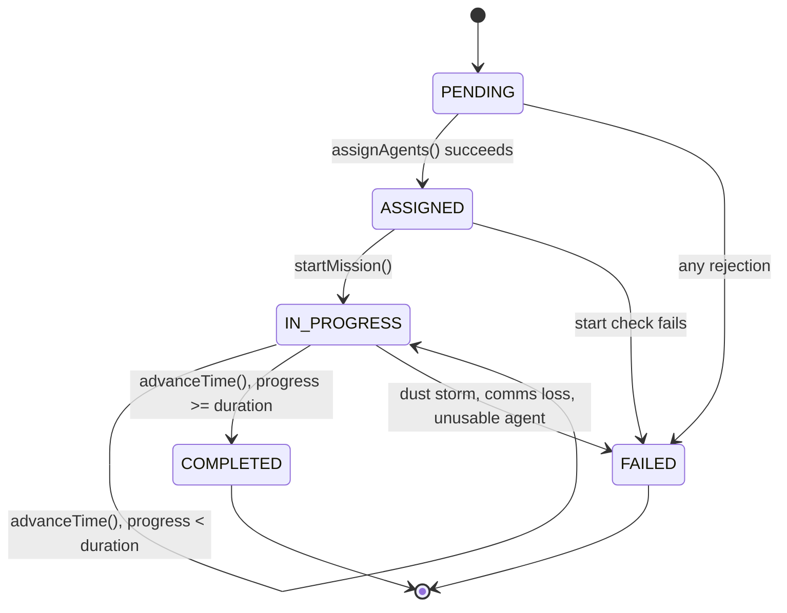

# MARS-OPS: Autonomous Mars Colony Management & Emergency Simulator

**Alexandria University, Faculty of Engineering**
Computer and Communication Engineering | Programming II | Fall 2026, Lab 5

## Team Members

| Name | ID |
|---|---|
| Youssef Aly Mahmoud | 10094 |
| Belal Mohamed Ahmed | 9852 |
| Mohamed Ahmed Elsayed | 9986 |
| Youssef Khalid Galal | 10090 |

---

## Table of Contents

1. [Overview](#1-overview)
2. [Features](#2-features)
3. [Project Structure](#3-project-structure)
4. [Class Diagram](#4-class-diagram)
5. [Class Reference](#5-class-reference)
6. [Getting Started](#6-getting-started)
7. [Demonstration Scenarios](#7-demonstration-scenarios)
8. [Design Decisions](#8-design-decisions)
9. [Mission Rules](#9-mission-rules)
10. [Resource Rules](#10-resource-rules)
11. [Emergency Rules](#11-emergency-rules)
12. [Environmental Effects](#12-environmental-effects)
13. [Testing](#13-testing)
14. [Known Limitations](#14-known-limitations)

---

## 1. Overview

MARS-OPS is a Java console simulation of a small research colony on Mars. The colony manages its people, robots, facilities, and resources, accepts missions, advances simulated time, reacts to environmental conditions, and responds to emergencies. It can print a full colony status report at any moment.

The design goal is that **objects collaborate**: no single class holds all the logic. `Colony` coordinates, but each object knows its own rules. For example, a mission never checks what kind of agent it was given. It asks `agent.canPerform(mission)`, and the agent answers for itself.

**Tech stack:** Java (JDK 9 or later, because the code uses `List.of` and `Map.of`), no external libraries, no build tool required.

## 2. Features

- **Agents with their own rules:** crew members (scientist, engineer, medical officer) and robots (exploration rover, repair robot, drone), each with health/fatigue or battery limits.
- **Four mission types:** exploration, repair, rescue, and research, each with its own start conditions.
- **Mission lifecycle:** `PENDING → ASSIGNED → IN_PROGRESS → COMPLETED / FAILED`, with a recorded failure reason for every rejection or failure.
- **Colony-wide resources:** seven resource types stored in facilities, with all-or-nothing consumption.
- **Emergency handling:** oxygen leaks are dispatched to an available human and robot responder, and are resolved or left unresolved with a reason.
- **Environmental conditions:** normal, dust storm, and communication disruption, which block or abort missions.
- **Status report:** `Colony.getStatusReport()` prints resources, agents, facilities, the active mission, and mission and emergency history.

## 3. Project Structure

```
StudentID-Prog-II-Lab5/
├── Project 5 Files/                          all Java source files (package lab5)
│   ├── Agent.java                 abstract: root of crew and robots
│   ├── CrewMember.java            abstract
│   ├── Scientist.java
│   ├── Engineer.java
│   ├── MedicalOfficer.java
│   ├── Robot.java                 abstract
│   ├── ExplorationRover.java
│   ├── RepairRobot.java
│   ├── Drone.java
│   ├── Facility.java              abstract
│   ├── Habitat.java
│   ├── Laboratory.java
│   ├── PowerStation.java
│   ├── CommunicationStation.java
│   ├── Resources.java
│   ├── Equipment.java
│   ├── EquipmentType.java         enum
│   ├── EquipmentCondition.java    enum
│   ├── Mission.java               abstract
│   ├── Exploration.java
│   ├── RepairMission.java
│   ├── RescueMission.java
│   ├── Research.java
│   ├── MissionType.java           enum
│   ├── MissionStatus.java         enum
│   ├── Emergency.java
│   ├── EmergencyType.java         enum
│   ├── EmergencyStatus.java       enum
│   ├── Environment.java           contains the EnvironmentCondition enum
│   ├── HealthStatus.java          enum (used by Robot)
│   ├── Colony.java                coordinator
│   ├── Simulation.java            advances time
│   └── main.java                  test driver (entry point)
├── class-diagram.mermaid
├── UMLClassDiagram.svg
└── README.md
```

## 4. Class Diagram

A simplified class diagram showing the main members and relationships. It is written in Mermaid, so it renders automatically on GitHub and in any Markdown viewer with Mermaid support. The Mermaid source is saved in class-diagram.mermaid, and a pre-rendered copy is in UMLClassDiagram.html (just double-click it to open it in a browser). To edit the diagram or export it as PNG/SVG, paste the source into mermaid.live. The mission lifecycle state diagram in section 9.2 is also written in Mermaid.


**Reading the diagram:** hollow triangle = inheritance, filled diamond = composition, hollow diamond = aggregation, plain arrow = association or dependency.



## 5. Class Reference

| Group | Classes | Purpose |
|---|---|---|
| **Agents** | `Agent` (abstract), `CrewMember` (abstract), `Scientist`, `Engineer`, `MedicalOfficer`, `Robot` (abstract), `ExplorationRover`, `RepairRobot`, `Drone` | Anything that can perform missions or respond to emergencies. Each agent answers `canPerform(Mission)` and `canHandle(Emergency)` itself. |
| **Facilities** | `Facility` (abstract), `Habitat`, `Laboratory`, `PowerStation`, `CommunicationStation` | Hold resource stock and have an operational status. |
| **Resources** | `Resources` | Quantities of oxygen, water, food, fuel, power, medical supplies, and spare parts. Also used as a mission's resource request. |
| **Equipment** | `Equipment`, `EquipmentType`, `EquipmentCondition` | Equipment carried by rovers, with a condition (working, damaged, destroyed). |
| **Missions** | `Mission` (abstract), `Exploration`, `RepairMission`, `RescueMission`, `Research`, `MissionType`, `MissionStatus` | Mission data and lifecycle. |
| **Emergencies** | `Emergency`, `EmergencyType`, `EmergencyStatus` | One emergency event, its responders, and its outcome. |
| **Environment** | `Environment` (with `EnvironmentCondition`), `HealthStatus` | Current Mars condition, and the health enum used by robots. |
| **Coordination** | `Colony`, `Simulation` | `Colony` owns everything and enforces colony-level rules. `Simulation` advances time. |
| **Testing** | `main` | Runs the required demonstration scenarios plus extra checks. |

## 6. Getting Started

**Requirements:** JDK 9 or later.

**NetBeans:** open the project, then choose *Run → Run Project* (F6). The main class is `lab5.main`.

**Command line** (from the parent folder that contains the `lab5` directory):

```bash
javac -d out lab5/*.java
java -cp out lab5.main
```

### Minimal usage example

```java
Colony colony = new Colony();

Habitat habitat = new Habitat("H1", "Habitat A");   // package-private constructor: use from package lab5
habitat.addResource("FUEL", 100);
colony.addFacility(habitat);

Scientist scientist = new Scientist(new ArrayList<>(List.of("EXPLORATION")),
        10, 100, "Dr. Amal", 1, true, "Habitat A");
ExplorationRover rover = new ExplorationRover("Rover-1", 101, "Habitat A", 3);
rover.loadEquipment(new Equipment(1, "Spectrometer", EquipmentType.SCIENTIFIC,
        EquipmentCondition.WORKING, "Rover-1"));
colony.addAgent(scientist);
colony.addAgent(rover);

Resources request = new Resources();
request.AddRequirement("FUEL", 10);
Exploration mission = new Exploration(1, "Explore Region Alpha", 3, request, null, 15,
        "Region Alpha", List.of(EquipmentType.SCIENTIFIC));

boolean accepted = colony.submitMission(mission, List.of(scientist, rover));
new Simulation(colony).advanceTime(3);              // mission completes after 3 time units
System.out.println(colony.getStatusReport());
```

## 7. Demonstration Scenarios

Running `lab5.main` executes all required scenarios in order, followed by one extra scenario and two extra test groups. Each scenario builds a **fresh colony** so scenarios never affect each other.

| Scenario | Method in `main` | Expected result |
|---|---|---|
| 1. Successful exploration | `scenario1SuccessfulExploration()` | Scientist and rover accepted. Mission goes `ASSIGNED → IN_PROGRESS → COMPLETED` over 3 time units. Status report printed before and after. Agents are available again and the rover battery has dropped. |
| 2. Mission rejection | `scenario2MissionRejection()` | The scientist lacks the `EXPLORATION` skill. The mission is `FAILED` immediately with "does not possess the required capability" and never becomes active. |
| 3. Resource shortage | `scenario3ResourceShortage()` | Mission asks for 500 fuel while the colony has 100. Rejected with `Insufficient FUEL ...`, fuel stays at 100, nothing goes negative. |
| 4. Emergency handling | `scenario4EmergencyHandling()` | **4a:** responders available, leak repaired, oxygen 300 → 250, spare parts 10 → 8, robot battery 100 → 95, `RESOLVED`. **4b:** robot unavailable, `UNRESOLVED` with a reason, oxygen 300 → 200 (deducted twice), nothing consumed. |
| 5. Environmental effect | `scenario5EnvironmentalEffect()` | **5a:** during a dust storm, exploration cannot start. **5b:** a storm during an active mission fails it and releases the agents. |
| 6. Research (extra) | `scenario6Research()` | **6a:** research completes after 2 time units and consumes 5 water. **6b:** research is blocked when the laboratory is on fire. |

To run a single scenario, comment out the other calls at the top of `main()`.

## 8. Design Decisions

### 8.1 The four OOP concepts

- **Encapsulation:** fields are private (or protected where subclasses need them). Lists are copied on the way in and returned as unmodifiable views (for example `Mission.getAssignedAgents()` and `CrewMember.getSkills()`). Values that must stay in range (health, fatigue, battery) are clamped or validated inside the object.
- **Abstraction:** `Agent`, `CrewMember`, `Robot`, `Facility`, and `Mission` are abstract and declare what every subclass must provide.
- **Inheritance:** `Scientist`, `Engineer`, `MedicalOfficer` extend `CrewMember`. `ExplorationRover`, `RepairRobot`, `Drone` extend `Robot`. Both extend `Agent`. The facility and mission hierarchies work the same way.
- **Polymorphism:** the colony and missions work with `Agent` and `Mission` references. `canPerform`, `canHandle`, `canOperateIn`, `canStartIn`, `update`, and `getStatusSummary` behave differently per subclass.

### 8.2 Capability requirements

A mission never checks the concrete type of an agent. It asks `agent.canPerform(mission)`, and emergencies ask `agent.canHandle(emergency)`.

- `CrewMember.canPerform` is true when one of the person's skills matches the mission type name (for example, the skill `"EXPLORATION"` for an `EXPLORATION` mission, case-insensitive).
- Robot subclasses decide by mission type, usable state, battery and, for the rover, carried equipment. `ExplorationRover` and `Drone` accept exploration and rescue. `RepairRobot` accepts repair only.
- Deliberate exceptions where `instanceof` is used: `Exploration.execute` looks for the assigned `ExplorationRover`, `Research` looks for its `Laboratory`, and `Colony.handleEmergency` separates one `CrewMember` from one `Robot`.

### 8.3 Available vs. usable vs. ready

| Term | Meaning | Method |
|---|---|---|
| Available | Not currently committed to a mission or emergency | `isAvailable()` |
| Usable | In working condition | `isUsable()` |
| Ready | Both available and usable | `isReady()` |

Usability thresholds (defined as constants):

- **Crew member:** usable when health > 30 and fatigue < 80 (both on a 0–100 scale).
- **Robot:** usable when health status is `OPERATIONAL` and battery > 0. To perform a mission it also needs `minBattery + 10` battery (10 is a reserve that must remain after the task).

### 8.4 Time effects on agents

Each time unit, `update()` is called on every agent:

- **Crew:** fatigue +2 if busy, −1 if idle.
- **Robots:** battery drains by the robot's own rate while busy (rover 5, repair robot 3, drone 4) and recharges +2 while idle.

### 8.5 Object relationships

| Relationship | Examples |
|---|---|
| **Inheritance** | Agent, facility, and mission hierarchies |
| **Composition** | `Facility` → `Resources` (`R1`, created in the constructor); `Colony` → `Environment` |
| **Aggregation** | `Colony` → agents, facilities, missions, emergencies; `ExplorationRover` → `Equipment` |
| **Association** | `Mission` → `Agent`, `Facility`, `Resources`; `Emergency` → `Facility`, `Agent`; `Simulation` → `Colony`; `RescueMission` → `Agent` |

### 8.6 Other decisions left open by the specification

- A new mission starts in `PENDING`. A rejected mission goes `PENDING → FAILED` and never becomes `ASSIGNED` or active.
- Agents are assigned **all-or-nothing**: `Mission.assignAgents` checks every agent first, and only if all pass does it mark them busy.
- Only a `PENDING` mission can be submitted. A failed mission is never retried (create a new mission object instead).
- Every agent must be registered in the colony, and the one-active-mission rule is enforced by `Colony`, not by the mission.
- Agent IDs are unique across humans and robots (they share one list in the colony).
- Facility status is a `String` (`OPERATIONAL`, `UNAVAILABLE`, `DESTROYED`), and only operational facilities count toward resource totals.

## 9. Mission Rules

### 9.1 Mission types

| Type | Class | Starts when | Notes |
|---|---|---|---|
| Exploration | `Exploration` | Not during a dust storm | Needs a rover with the required equipment types and enough battery. |
| Repair | `RepairMission` | Always (indoor work) | Targets exactly one facility. Minimum battery 5. |
| Rescue | `RescueMission` | Not during communication disruption | Refers to the stranded agent. |
| Research | `Research` | Target laboratory is operational, not on fire, and has all required equipment undamaged | Done by scientists, so no battery is needed (`minBattery = 0`). |

### 9.2 Mission lifecycle



- A mission starts counting its duration when it becomes `IN_PROGRESS`. Each time unit adds 1 to its progress.
- Only `startMission`, `advanceTime`, `complete`, `failMission`, and `assignAgents` change a mission's state, and each refuses an illegal move (for example, `complete()` on a `PENDING` mission does nothing).
- Agents are released on both completion and failure. A mission that fails from `PENDING` never marked its agents busy, so it releases nobody.
- Every rejected or failed mission stores a failure reason (`getFailureReason()`).

### 9.3 Rejection reasons

A submitted mission becomes `FAILED` immediately with a clear reason if:

- another mission is already active,
- the environment blocks it (for example, a dust storm for exploration),
- an agent is not registered in the colony or cannot operate in the current environment,
- required resources are insufficient, or
- an agent is missing, not ready, or lacks the required capability.

### 9.4 One active mission at a time

The colony keeps one `activeMission`. Emergency responses are not subject to this limit, but responders must be available (not part of the active mission).

## 10. Resource Rules

Resources are stored in facilities (`Facility.R1`) and managed at the colony level.

- **Colony-wide total** = sum over all *operational* facilities. Stock in a destroyed or unavailable facility does not count.
- A request may be supplied by several facilities (for example, 300 oxygen in one and 200 in another can satisfy a 450 request, but not 600).
- **All-or-nothing:** the colony checks the whole request before touching anything. If any single resource is short, nothing is consumed and the mission fails with a reason such as `Insufficient FUEL: required 500.0, available 100.0.`
- Quantities never go negative: removal refuses to exceed stock, and an oxygen leak is clamped at zero.
- **Consumption timing:** a mission's resources are consumed when the colony accepts the mission.
- **Allocation policy:** facilities supply in the order they were added to the colony.
- Resources consumed by an accepted mission are **not refunded** if the mission later fails.

## 11. Emergency Rules

### 11.1 General rules

- An emergency has a type, an affected location (a facility or the Martian surface), and a status: `ACTIVE`, `RESOLVED`, or `UNRESOLVED`.
- A responder is appropriate if it reports `canHandle(emergency)`. It must also be available and usable.
- Dispatching moves responders to the affected facility, and they are released when the response ends.
- Emergencies do not interrupt the active mission.
- If the required responders are unavailable, the emergency is marked `UNRESOLVED`, a reason is recorded, no response resources are consumed, and it is not retried automatically.

### 11.2 Oxygen leak (implemented)

`Colony.handleEmergency(...)` is triggered manually. The steps are:

1. The leak amount (for example 50) is deducted from the affected habitat only, lowering the colony total.
2. The colony picks one available human and one available robot that report they can handle the emergency.
3. Everything is checked **before** anything is consumed: a human, a robot, enough robot battery, and enough spare parts.
4. If all checks pass, the responders are dispatched, the repair costs 2 spare parts and 5 battery, the leak is sealed, and the emergency is `RESOLVED`.
5. If any check fails, the **same amount is deducted again** (an unresolved leak costs twice the oxygen), the emergency is `UNRESOLVED` with a reason, and nothing is consumed.

Habitat oxygen never falls below zero. A leaking habitat stays `OPERATIONAL`, so its other stock (water, food) still counts toward colony totals.

### 11.3 Required responders per type

| Emergency | Location | Required responders | Status |
|---|---|---|---|
| Oxygen leak | Habitat | 1 human + 1 robot | Implemented (`Engineer` and `RepairRobot`) |
| Fire | Laboratory | 1 human + 1 robot | Modeled only |
| Rover breakdown | Martian surface | 1 robot | Modeled only |
| Medical emergency | A facility | 1 human | Modeled only |

## 12. Environmental Effects

| Condition | Effects |
|---|---|
| Normal | No restriction. |
| Dust storm | Exploration missions cannot start. Rovers cannot operate. An active exploration mission fails. |
| Communication disruption | Rescue missions cannot start. Remotely controlled drones cannot operate. |

Repair and research missions are indoor work and are not blocked by either condition.

**Running missions:** if a new condition is incompatible with an active mission (for example, a dust storm during exploration), the mission moves to `FAILED` with a reason naming the condition, and its agents are released. Consumed resources are not refunded. Unaffected missions continue normally.

## 13. Testing

`lab5.main` serves as the test driver. Besides the scenarios in section 7, it contains two extra test groups:

- `runResourceTests()`: adding, removing, and checking resources, invalid types, insufficient requests, and a successful transaction.
- `runCrewTests()`: health and fatigue clamping, usability thresholds, and the `isReady()` rule.

There is no JUnit setup. Results are checked by reading the console output against the expected values in the comments of `main.java`.

## 14. Known Limitations

- Only the **oxygen leak** emergency has a response procedure. Fire, rover breakdown, and medical emergencies are modeled (types, required responder counts, `Laboratory.catchFire()`, `ExplorationRover.breakDown()`), but `Colony.handleEmergency` marks them `UNRESOLVED` immediately, and only `Engineer` and `RepairRobot` report `canHandle(OXYGEN_LEAK)`.
- `Exploration.execute(Colony)` exists but is not called by `Colony` or `main`. The colony starts missions itself in `advanceTime()`.
- There is no dedicated storage facility class.
- `Laboratory` keeps its equipment as a list of names, so facilities are not linked to the `Equipment` class. Only rovers carry `Equipment` objects.
- Facility status is stored as a `String` rather than an enum.
- `Facility.R1` is a public field, and some method names do not follow Java conventions (`GetFacilityInfo`, `AddResources`, `setStatuesOPERATIONAL`).
- `Resources` prints a message on every add or remove, which makes console output noisy.
- `Habitat`, `Laboratory`, and `PowerStation` constructors are package-private, unlike `CommunicationStation`, so they can only be created from inside package `lab5`.
- `Mission.getRequiredEquipment()` is documented as overridden by "ExplorationMission", but the class is named `Exploration`.
